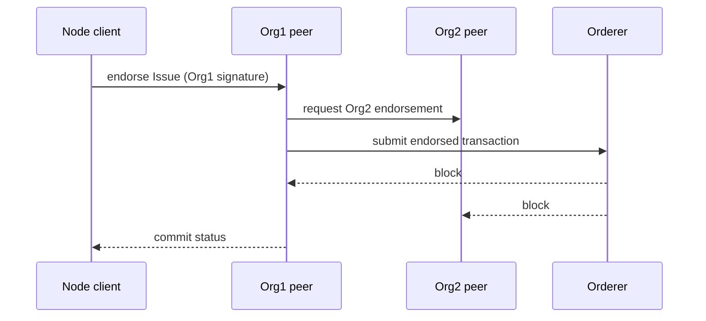

# Hyperledger Fabric, running locally

This repository is a small, runnable introduction to [Hyperledger Fabric](https://hyperledger-fabric.readthedocs.io/). It starts the official two-organization test network in Docker, deploys an invoice chaincode, and drives that chaincode with a Node.js client that uses the Fabric Gateway API.

Fabric 3.1.5 is the peer and orderer version. Fabric CA 1.5.22 enrolls the application users. Both are downloaded into `.fabric/` by the scripts; that directory is gitignored because it is a large upstream checkout plus binaries.

## What you are building

Two companies share one channel, `mychannel`. Each company is a Fabric organization with its own membership service provider (MSP), certificate authority, and peer:

| Organization | MSP ID | Peer | Gateway address | Role in the demo |
| --- | --- | --- | --- | --- |
| Org1 | `Org1MSP` | `peer0.org1.example.com` | `localhost:7051` | Issues an invoice |
| Org2 | `Org2MSP` | `peer0.org2.example.com` | `localhost:9051` | Accepts and pays it |

A single Raft orderer (`orderer.example.com` on `localhost:7050`) orders transactions into blocks. The peers keep the ledger. Chaincode is the program that runs the invoice rules. The Node application never talks to the orderer directly: it opens one gRPC connection to Org1's peer, and that peer's gateway collects endorsements, submits the transaction, and waits until the block is committed.



The default endorsement policy on this channel is a majority of organizations. With two organizations, both peers must execute the chaincode and return the same result. That is why a gateway connected only to Org1 still calls Org2 before anything is written.

## The invoice contract

`chaincode/invoice` is a Go chaincode built with `fabric-contract-api-go`. World state is a key/value map. Each invoice is stored under `invoice:<id>`.

| Transaction | Who can call it | State change |
| --- | --- | --- |
| `Issue` | Any org, naming a different org as payer | create `ISSUED` |
| `Accept` | Payer organization | `ISSUED` → `ACCEPTED` |
| `Pay` | Payer organization | `ACCEPTED` → `PAID` |
| `Cancel` | Issuer organization | `ISSUED` or `ACCEPTED` → `CANCELLED` |
| `Read`, `List`, `History` | Either organization | none (query) |

The caller's organization comes from the X.509 identity that signed the transaction (`cid.GetMSPID`), not from an argument the client can forge. `contract/transition.go` holds the state machine, and `go test` covers it without a network.

Writes go through `submitTransaction`. Reads go through `evaluateTransaction`, which executes the chaincode but does not create a block.

## Prerequisites

- Docker, with the daemon running. The peers mount `/var/run/docker.sock` and start a container for the chaincode.
- `git`, `curl`, `jq`, Go 1.22 or newer, and Node.js 20 or newer.
- Enough disk for the Fabric images (a few gigabytes).

If this machine has no systemd, start the daemon in the background:

```bash
sudo dockerd --host=unix:///var/run/docker.sock
```

`scripts/ensure-docker.sh` does that when the socket is missing and `sudo` is available.

`scripts/up.sh` checks whether containers on a Docker bridge can reach each other. When they can, it uses the stock test network. When the bridge drops that traffic, it switches the peers, the orderer, and the chaincode containers to the host network and maps `orderer.example.com`, `peer0.org1.example.com`, and `peer0.org2.example.com` to `127.0.0.1`. The localhost ports in the table above stay the same. The compose files for that fallback are in `network/hostnet/`.

## Run it

```bash
chmod +x scripts/*.sh
./scripts/up.sh                 # network, CAs, and channel mychannel
./scripts/deploy-chaincode.sh   # package, install, approve, commit
./scripts/demo.sh               # issue, accept, pay, and query
./scripts/down.sh               # remove containers and generated crypto
```

The same targets exist on the `Makefile`: `make up`, `make deploy`, `make demo`, `make down`, and `make test`.

`up` calls the upstream installer (`install-fabric.sh -f 3.1.5 -c 1.5.22 binary docker samples`) and then:

```bash
./network.sh up createChannel -c mychannel -ca
```

`-ca` tells the test network to enroll Org1 and Org2 with Fabric CA instead of generating certificates offline. The users the client signs as are `User1@org1.example.com` and `User1@org2.example.com`. Their keys and certificates land in `.fabric/fabric-samples/test-network/organizations/`.

`deploy-chaincode.sh` runs the chaincode lifecycle against `chaincode/invoice`:

1. `go mod vendor` on the host, so the peer builds without fetching modules again.
2. `peer lifecycle chaincode package` produces a tarball labeled `invoice_1.0`.
3. Each organization installs that package on its peer and approves the definition.
4. Once both approvals are recorded, either organization commits the definition to `mychannel`. The peers then build and start the chaincode container.

The first deploy is the slow step: Docker builds the chaincode image.

## What the demo prints

`application/app.js` connects twice to `localhost:7051`. Both connections use Org1's TLS certificate to authenticate the peer. They differ in the signing identity:

- Org1 issues `inv-<timestamp>` for 125000 USD, payable by `Org2MSP`.
- Org1 tries to accept it and is rejected.
- Org2 accepts, then pays.
- Org1 tries to cancel the paid invoice and is rejected.
- Org1 issues a second invoice and cancels it, which the issuer is allowed to do while it is still `ISSUED`.
- Org1 reads the history of the paid invoice. Each entry is a transaction id, a timestamp, and the invoice JSON written by that transaction.
- Org2 lists every invoice.

Override the defaults with `CHANNEL_NAME`, `CHAINCODE_NAME`, `INVOICE_ID`, `PEER_ENDPOINT`, `PEER_HOST_ALIAS`, or `TEST_NETWORK_ORG_PATH` if you pointed the scripts at a different checkout.

## Where the files map to Fabric concepts

| Path | Concept |
| --- | --- |
| `scripts/up.sh` | Ordering service, peers, CAs, and a channel |
| `scripts/deploy-chaincode.sh` | Chaincode lifecycle (package, install, approve, commit) |
| `chaincode/invoice` | Chaincode: the deterministic program peers endorse |
| `application/app.js` | Client application using the Fabric Gateway |
| `.fabric/fabric-samples/test-network` | The upstream Docker Compose network the scripts wrap |

## Keep going

The test network is a development topology, not a production one. A production network adds more orderer nodes, durable storage, and an operations process for channel configuration. The Fabric docs cover those next:

- [A blockchain platform](https://hyperledger-fabric.readthedocs.io/en/latest/blockchain.html)
- [The network](https://hyperledger-fabric.readthedocs.io/en/latest/network/network.html)
- [Chaincode lifecycle](https://hyperledger-fabric.readthedocs.io/en/latest/chaincode_lifecycle.html)
- [Gateway application development](https://hyperledger-fabric.readthedocs.io/en/latest/developapps/developing_applications.html)
- [Test network tutorial](https://hyperledger-fabric.readthedocs.io/en/latest/test_network.html)
